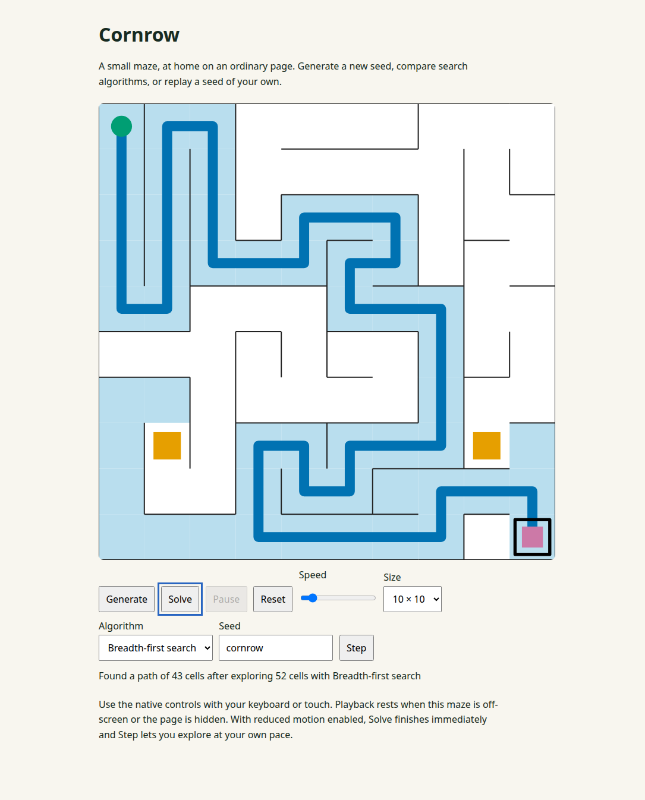

# Cornrow

A playful, library-first maze lab: generate a maze, follow a search, and tuck it
into a page of your own. Cornrow is an npm package, with a small playable demo in
`demo/`. It has no runtime or peer dependencies and needs no framework.



## Install and embed

```sh
npm install @cirsteve/cornrow
```

```html
<div id="maze"></div>
```

```ts
import { mountCornrow } from '@cirsteve/cornrow';

const host = document.querySelector<HTMLElement>('#maze');
if (!host) throw new Error('Missing maze host');
const maze = mountCornrow(host, {
  mode: 'interactive', // default; choose 'background' for decoration
  seed: 'cornrow', rows: 10, cols: 10,
  stepsPerSecond: 60, label: 'A small detour',
});
maze.solve();
const unsubscribe = maze.on(event => console.log(event.type));
// On navigation or component unmount:
unsubscribe();
maze.destroy();
```

The wrapper lives inside your host with a shadow root that contains its styles,
Canvas, and native controls. It follows the host width. Give the host the width
and placement you want. Mounting leaves existing host content and attributes
alone. Destroy removes the wrapper and releases listeners, observers,
subscriptions and animation frames; calling it again is safe.

Options are `mode`, `seed` (string or number), `rows`, `cols`, `solver` (a branded
id obtained from `getSolver`), `stepsPerSecond`, and the accessible `label`.
Defaults are interactive mode, a fresh seed, 20 × 20 cells, BFS, and 60 steps per
second (30 in background mode). Speeds are bounded to 1–500. The returned handle
has `generate(options?)`, `solve(solverId?)`, `pause()`, `resume()`, `reset()`,
`on(listener)` (returns an unsubscribe function), and `destroy()`. `generate()`
uses a fresh seed unless one is supplied. Mode is chosen at mount time; destroy
and mount again to change it.

For a decorative background, mount into a positioned host behind your content:

```ts
const decoration = mountCornrow(backgroundHost, { mode: 'background' });
// Later: decoration.destroy();
```

Background mode has no controls, status line, or focusable elements. Its wrapper
is aria-hidden, ignores pointer input, and has opacity 0.35. It autoplays a slow
generate → solve → hold → regenerate loop, alternating BFS and A*, holding each
solution for 2.5 seconds of visible playback and choosing a fresh seed each cycle.
Both modes pause while off-screen or while the document is hidden. Host
suspension preserves an explicit pause made through the handle.

With `prefers-reduced-motion`, interactive Solve completes immediately and a Step
button lets you inspect one event at a time. Background mode renders a static
solved frame and requests no animation frames. Preference changes are tracked
live. If Canvas is unavailable, a text summary reports seed, dimensions, solver,
outcome, visited count and path length. Without animation APIs,
solves also complete synchronously.

For a complete consumer, see [examples/host-page](examples/host-page): a plain
newsletter page with an interactive and a background instance, installed from
`npm pack` and loaded through an import map without a bundler.

## Headless use

Importing the public entry touches no DOM/window globals. Generation and search
work in Node as well as browsers:

```ts
import { generate, getSolver, solve, checkPath } from '@cirsteve/cornrow';

// The reproducible sample: seed 'cornrow', 10 × 10.
const { environment } = generate({ seed: 'cornrow', rows: 10, cols: 10 });
const solver = getSolver('astar'); // 'bfs' is also available
if (solver.ok) {
  const { result, events } = solve(environment, solver.value.id);
  if (result.outcome === 'found') {
    console.log(result.path, checkPath(environment, result.path, environment));
  }
  console.log(events);
}
```

Generation uses a seeded iterative recursive backtracker (depth-first search)
that carves a spanning tree: every cell is reachable and there is one route
between any two cells. The generator records its id, version, seed, and options
alongside the immutable maze, so a seed can be replayed.

Breadth-first search (BFS) uses a queue and finds a shortest path in an unweighted
grid. A* uses the Manhattan distance heuristic and a min-heap. Both expose the
same generator/trace contract: `frontier-add` when a node is enqueued, `visit`
when it is expanded, and exactly one `path` event before a `found` result. An
`unreachable` result emits no path event. Cancellation is a separate outcome.
The playback controller records events for replay; rendering consumes trace
state without knowing which solver produced it.

Coordinates are **(row, col)** from the top-left. Node id is `row * cols + col`.
The four-neighbour grid orders neighbours north, east, south, west; walls are
absent passages, and passage bits are N=1, E=2, S=4, W=8. Default start is (0,0)
and default goal is (rows−1, cols−1). Each size is rounded and clamped to 5–80
cells per side. The renderer's wall masks describe walls present, the inverse
of model passage bits.

## Development

```sh
bun install --frozen-lockfile
bun run dev            # playable demo, served by Vite
bun run test           # Vitest: node by default, happy-dom for mount tests
bun run test:watch
bun run test:package   # build, pack and typecheck Node16/NodeNext consumers
bun run typecheck
bun run build          # dist/cornrow.js plus dist/index.d.ts and referenced declarations
bun run example:pack   # pack and install in the static host example
npm pack --dry-run     # inspect the publication whitelist (also runs prepack build)
```

The ESM library build uses Vite, followed by plain tsc declaration emit. The
package contains only dist/, package.json, README.md and LICENSE. Tests include
an import of the public entry in Node followed by generation and both solvers,
and instrumented browser lifecycle accounting for mount/destroy.

License: [MIT](LICENSE), copyright 2026 cirsteve. `npm publish` is an operator-only
step after confirming the package name `@cirsteve/cornrow` and the licence.
